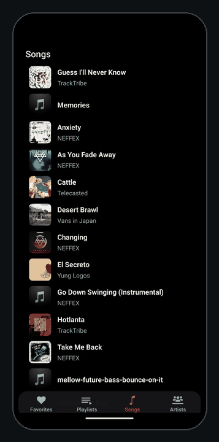

# MusicPlayer 🎵

Mobile music player built with **React Native**, **Expo** and **Expo Router**. It streams the tracks of a local
library and organises them in tabs — **Songs**, **Artists**, **Playlists** and **Favorites** — with a floating
mini player that stays above the tab bar while you browse.

**▶ Live demo: [cuencaoscar.github.io/MusicPlayer](https://cuencaoscar.github.io/MusicPlayer/)** (web build of the same app)
· **[⬇ Android APK](https://github.com/CuencaOscar/MusicPlayer/releases/latest)**


<p align="center"></p>

## Features

- **Playback** with `expo-av`: tap any song to play the list from there, pause/resume, skip to the next track and
  automatic advance when a track ends. The playing track is highlighted in every list.
- **Floating mini player** with artwork, title, artist and controls, shared across tabs through a React context.
- **Artists and Playlists** grouped from the library, **Favorites** from the track rating.
- Artwork fallback when a remote image fails to load, and empty states for lists without content.
- Shared design tokens for colours, spacing and typography; strict TypeScript, ESLint and Prettier.

## Tech stack

- React Native 0.74 · Expo SDK 51 · TypeScript
- Expo Router (file-based navigation), `expo-av`, `expo-image`, `expo-blur`
- ESLint + Prettier, Jest (`jest-expo`) and GitHub Actions

## Project structure

```
src/
├── app/
│   └── (tabs)/       # songs, artists, playlists, favorites + mini player
├── components/       # TracksList, TrackListItem, GroupList, FloatingPlayer, Artwork, EmptyState
├── providers/        # PlayerProvider (queue and playback state)
├── helpers/          # Typed library, artist/playlist grouping
├── constants/        # Design tokens, images
└── styles/
```

## Getting started

```bash
npm install
npx expo start
npm run typecheck && npm run lint && npm test
```

Build an Android release locally with `cd android && ./gradlew assembleRelease`.

## License

[MIT](LICENSE) © Oscar Cuenca · [LinkedIn](https://www.linkedin.com/in/ocuenca-moreno/)
